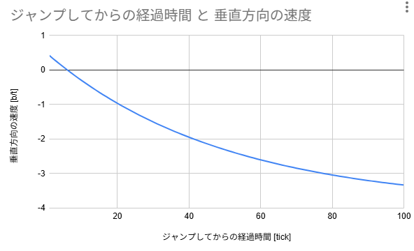
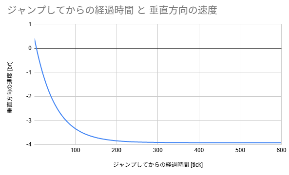
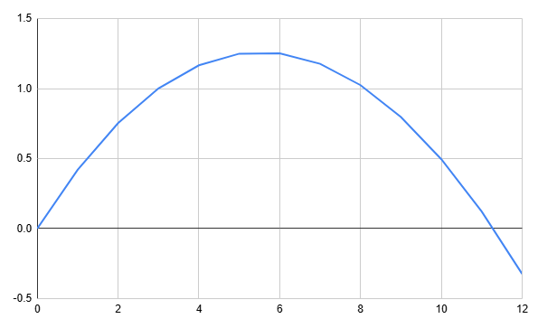

# 第1部 垂直方向の物理

# 1. ジャンプとは

Minecraftにおいて、ジャンプとは「一瞬だけ上向きの速度が与えられること」である。

ここで重要なのは上向きの速度が与えられるのはジャンプ入力をした一瞬のみであるという点だ。

そのため、空中にいる間にジャンプキーを押しても軌道が変化することはない。

ジャンプをした後は重力と空気抵抗によってのみ速度が変化する。

具体的には、0.42の上向きの速度が与えられる。

MCPKwikiの $V_{Y,1}=0.42$ がまさしくこのことを意味している。

# 2. 垂直方向の公式

MCPKwikiを参照すると、垂直方向の式は以下で与えられている。

$$
V_{Y,1}=0.42\\V_{Y,t}=\left( V_{Y,t-1}-0.08\right) \times 0.98
$$

まずはこの式を分かりやすくしていきたい。

しばらくは垂直方向の速度のみを扱うので、添え字のYを削除する。

ついでに、今後の都合上式を展開する。

すると、このように変形できる。

$$
\begin{split}
V_t&=0.98V_{t-1}-0.08\times0.98\\
&=0.98V_{t-1}-0.0784\end{split}
$$

この式を垂直方向の式とする。

<aside>
💡

垂直方向の式

$$
V_1=0.42\\V_t=0.98V_{t-1}-0.0784
$$

</aside>

実際に、垂直方向の式を使って、 $V_2$ を求めてみる。

垂直方向の式に $t=2$ を代入すると

$$
\begin{split}
V_2&=0.98\times0.42-0.0784\\
&=0.3332\end{split}
$$

こういった具合で、1tick前の速度を用いて今の速度を求めることができる。

この式を繰り返し使えば、これ以降の速度も求めるとができる。

実際に求めると以下のようになる。(四捨五入済み)

| ジャンプしてからの経過時間 [tick] | 垂直方向の速度 [block/tick] |
| --- | --- |
| 1 | 0.42 |
| 2 | 0.3332 |
| 3 | 0.2481 |
| 4 | 0.1648 |
| 5 | 0.0831 |
| 6 | 0.003 |
| 7 | -0.0754 |
| 8 | -0.1523 |
| 9 | -0.2277 |
| 10 | -0.3015 |
| 11 | -0.3739 |
| 12 | -0.4448 |

これを見ると、ジャンプしてから6tick目までは上向きの速度を有しているが、それ以降は下向きの速度になっていることが分かる。

このことから、ジャンプの頂点は6tick目になることが分かる。

# 3. バケツのモデルと終端速度

## 3.1 速度が正の場合

垂直方向の式を言語化してみよう。

$$
V_t=0.98V_{t-1}-0.0784
$$

この式の $0.98$ と $-0.0784$ は何を表しているのかを考える。

例えとして、穴の開いたバケツを用意する。

そのバケツには最初に水が入っているが、時間につれて穴から水が漏れだしていく。

さらにバケツの水をすくって外に出す人がいるとする。

このバケツの例えを使うと、垂直方向の式はこのように理解できる。

バケツに最初は 0.42 だけ水が入っている。

しかし、そのバケツには小さな穴が開いており、毎tick 0.98 倍、つまり 98% の水しか残らない。

さらに毎tick 0.0784 だけ水をすくってバケツの外に出してしまう。

このようにとらえると、式が一段と直感的になる。

まず初速 0.42 が与えられ、その後は 98% の割合で低減していき、さらに常に 0.0784 だけ速度が失われ続ける。

このようにして、最初の速度 0.42 がどんどんと減っていくのである。

実際に、ジャンプしてからの経過時間と速度をグラフにすると以下のようになる。

なだらかに下がっていっているのが分かると思うが、これはバケツに穴が開いているからと解釈できる。

水が減っていくと、やがて水は無くなる。正確には負の量の水になる。

このように、モデルでは水の量、すなわち速度が負になると途端に分かりにくくなる。

そこで、次節で見ていく通り、速度が負の場合は符号を反転させて考える。

## 3.2 速度が負の場合

垂直方向の式の符号を反転させて、以下のようにする。

$$
W_{t}=0.98W_{t-1}+0.0784
$$

重力のかかる方向が変わるだけなので、0.98の符号は変わらない。

このようにすると、バケツの解釈は次のようになる。

バケツに最初はいくらかの水が入っている。

しかし、そのバケツには小さな穴が開いており、毎tick 0.98 倍、つまり 98% の水しか残らない。

さらに毎tick 0.0784 だけ水が**蛇口から入ってくる**。

このように、0.0784 の符号が変わったため、バケツから水が出ていくのではなく入っていくことになった。毎回 0.98 倍の水しか残らないのは一緒だが、バケツに常に水が補充されるようになった。これによりバケツの水はなだらかに増えていく。

## 3.3 終端速度

では、もし時間がずっと経ったらどうなるだろう。

はじめのうちはバケツの穴から出る水の量が少なかったため、水は増えていった。

しかし、水が多くなるにつれ、穴から漏れ出る水の量も増えていく。

そうするとやがてバケツから漏れだす水の量と蛇口から流入する水の量がつり合う。こうなると、水の漏れ出る量も流入量も変わらないので、水の量は一定になる。

速度の話に戻せば、空気抵抗と重力が釣り合っている状態である。

このような状態を定常状態と呼び、このときの速度を終端速度という。

では、終端速度 $W$ を求めてみよう。

終端速度では、水の量が変わらない。つまり $W_t=W_{t-1}=W$ である。

これを符号を変えた垂直方向の式に代入すると、

$$
W=0.98W+0.0784
$$

となる。これを解くと、 $W=3.92$ が得られる。

符号を反転していたので、元の符号に戻せば、終端速度 $V$ は、 $V=-3.92$ と求まる。

<aside>
💡

垂直方向の終端速度 $V$

$$
V=-3.92
$$

</aside>

実際に、ジャンプしてからの経過時間と速度をより長い時間でグラフにすると以下のようになる。

300 tickを越えたあたりから、速度がほぼ一定になっていることが分かるだろう。

そして、その値は-4に届かないくらいの値である。

# 4. 垂直方向の位置

これまで速度を扱ってきたが、この節では位置について扱う。

そもそも速度とは、「1tickあたりの位置変化」である。

つまり、時刻 t tickでの垂直方向の位置 $Y_t$ は以下のように書ける。

$$
V_t=Y_t-Y_{t-1}
$$

この式を変形すると、

$$
Y_t=Y_{t-1}+V_t
$$

となる。この式を用いることで、時刻 t tickでの垂直方向の位置 $Y_t$ を求めることができる。

例えば、時刻 0 tickでの垂直方向の位置 $Y_0$ が 0 のときを考える。

このとき、 $V_1=0.42$ なので、時刻 1 tickでも位置は、 $Y_1=Y_0+0.42=0.42$ となる。

次に、時刻 2tickでは、$Y_2=Y_1+V_2=0.42+0.3332=0.7532$ と求まる。

これを繰り返していけば、時刻 t tickでの垂直方向の位置 $Y_t$ が求まる。

これ以降を求めると以下のようになる。

| ジャンプしてからの経過時間 [tick] | 垂直方向の速度 [b/t] | 垂直方向の位置 [b] |
| --- | --- | --- |
| 0 | 0 | 0 |
| 1 | 0.42 | 0.42 |
| 2 | 0.3332 | 0.7532 |
| 3 | 0.2481 | 1.0013 |
| 4 | 0.1648 | 1.1661 |
| 5 | 0.0831 | 1.2492 |
| 6 | 0.003 | 1.2522 |
| 7 | -0.0754 | 1.1768 |
| 8 | -0.1523 | 1.0245 |
| 9 | -0.2277 | 0.7968 |
| 10 | -0.3015 | 0.4953 |
| 11 | -0.3739 | 0.1214 |
| 12 | -0.4448 | -0.3234 |

これを見ると、速度の時に見た通り、ジャンプしてから6tick経ったところで垂直方向の位置が頂点に達していることが分かる。

また、12tick経ったところで、垂直方向の位置が負に転じているため、もし床があるなら12tick目で着地するということが分かる。これがAirtime=12の正体である。

さて、経過時間と位置をグラフにすると次のようになる。

概ね放物線のような軌道になっていることが分かるだろう。

# 5. 現実世界との比較

この章では、現実世界の垂直方向の運動とMinecraftの世界の運動を比較する。

Minecraftについてしか興味がない人は読み飛ばしてもらって構わない。

まず、現実世界での垂直方向の軌道は、綺麗な放物線を描くことが知られている。

つなり、式に表すと、垂直方向の位置 $y(t)$ は以下のようになる。

$$
y(t)=at^2+bt+c
$$

次に、Minecraftの世界を考える。

高校数学の知識を用いて、垂直速度の公式から $V_t$ を求めると、定数 $A,\,B$を用いて次のように表せる。

$$
V_t=A\times0,98^t+B
$$

よって、位置 $Y_t$ は定数 $C,\,D,\,E$ を用いて次のように表せる。

$$
\begin{split}
Y_t&=Y_0+\sum_{i=0}^{t} V_t \\&= C+D\times0,98^t+Et 
\end{split}
$$

これは、放物線ではなく、指数関数と直線の和である。

では、なぜ経過時間と位置のグラフは放物線に近く見えたのだろうか。

$0.98^t$ を $1-0.02$ とみなし、二項展開すると、次のようになる。

$$
\begin{split}
0.98^t&=\left(1-0.02\right)^t=1-0.02t+\dfrac{t(t-1)}{2}0.02^2+\cdots\\
&=1-0.02t+0.0002t(t-1)+\cdots\\
&=1-0.0202t+0.0002t^2+\cdots
\end{split}
$$

0.02の3次以上の項は微小項なので無視すると、

$$
0.98^t\approx 1-0.0202t+0.0002t^2
$$

と書ける。これを、

$$
Y_t=C+D\times0,98^t+Et 
$$

に代入すれば、定数 $F,\,G,\,H$ を用いて、次のようになる。

$$
Y_t\approx Ft^2+Gt+H
$$

このように、Minecraftの世界の垂直位置は、現実世界の垂直位置の軌道である放物線に近似できる。

そのため、Minecraftの世界の垂直位置も放物線に見えたのであった。

# 6. まとめ

Minecraftの垂直方向の速度は

$$
Vt=0.98V_{t−1}−0.0784
$$

で更新され、空気抵抗と重力によって変化する。

ジャンプは最初の1tickだけ上向きの速度を与え、その後はこの式に従って減速・落下していく。

この運動には終端速度があり、位置を積み上げると軌道は放物線に近い形になる

---

[1](01.md) ｜ [2](02.md) ｜ [3](03.md) ｜ [次に進む →](02.md)
