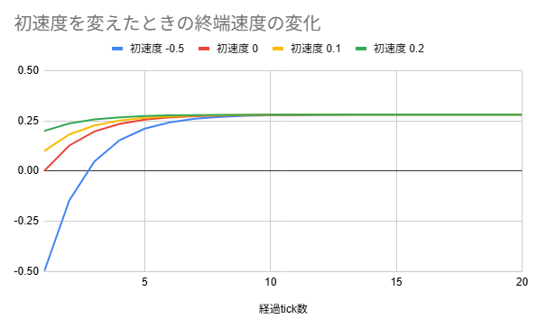
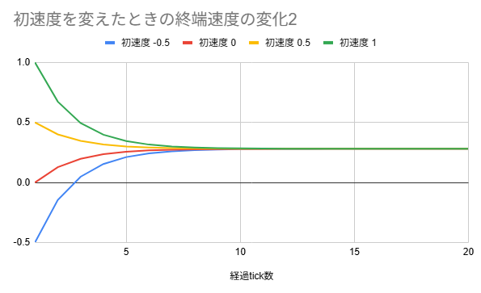
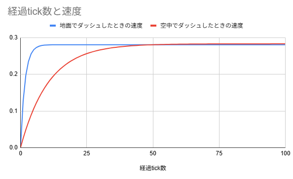

# 第2部 地面と空中の物理

# 1. 地面の式

## 1.1 地面の式の導出

MCPK wikiを参照すると、プレイヤーが地面にいるときの速度 $V_{H,t}$ の式はこのようになっている。

$$
V_{H,t}=V_{H,t-1}\times S_{t-1}\times 0.91 + 0.1\times M_t \times E_t \times \left(\dfrac{0.6}{S_t}\right)^3
$$

まず、 $M_t$ は移動方法の倍率と言われ、例えばダッシュ状態では 1.274 、歩き状態では 0.98 といったように決まっている。

今回は $M_t$ は時間によって変わらず常に同じだと考えることにする。

例えばダッシュを選ぶならずっとダッシュしっぱなし、歩くならずっと歩きっぱなしの状態を考えるという意味である。

そのため、時間に依存しなくなるので、単に $M$ と表すことにする。

次に、$E_t$はエフェクトの倍率と呼ばれ、移動速度上昇などのエフェクトがかかっている場合に変化する値だ。

今回はエフェクトなしの状態を考えるので、常に1とする。

最後に、 $S_t$ は滑りやすさの倍率と言われ、地面が通常か、空中か、またスライムや氷などかによって変動する値だ。

例えば通常の地面は 0.6 、空中は 1.0 である。

勘違いしやすい点として、摩擦と分けて考える必要がある。あくまで滑りやすさの値なので、値が大きいほど、より滑る、つまり摩擦は小さくなる。

しばらくの間、 $S_t$ は変動しないものとして扱う。つまり、地面から空中に移動したなどのケースは考えないことにする。

そのため、 $S_t$ は時間に依存しない定数と扱えるので、単に $S$ と表すことにする。

長くなったが、準備をしたことで、ようやく複雑だった式を見やすくできる。

これまでで決めた値を地面の式に代入する。

垂直方向の式の時と同様に、 $V_{H,t}$ と表すことにすると、

$$

V_t = V_{t-1} \times S \times 0.91+0.1\times M\times \left(\dfrac{0.6}{S}\right)^3

$$

となる。

<aside>
💡

地面の式

$$

V_t = V_{t-1} \times S \times 0.91+0.1\times M\times \left(\dfrac{0.6}{S}\right)^3

$$

</aside>

## 1.2 歩きとダッシュのときの地面の式

まだ分かりづらいので、具体例で考える。

例えば、通常の地面を歩いている状態を考える。このとき、  $M=0.98$であり、 $S=0.6$ なので、これらを地面の式に代入すると、

$$

\begin{split}
V_t &= V_{t-1} \times 0.6 \times 0.91+0.1\times 0.98\times \left(\dfrac{0.6}{0.6}\right)^3\\
&= 0.546V_{t-1} +0.098
\end{split}

$$

となる。

次に、通常の地面をダッシュしている状態を考える。このとき、  $M=1.3\times0.98=1.274$であり、 $S=0.6$ なので、これらを地面の式に代入すると、

$$

\begin{split}
V_t &= V_{t-1} \times 0.6 \times 0.91+0.1\times 1.274\times \left(\dfrac{0.6}{0.6}\right)^3\\
&= 0.546V_{t-1} +0.1274
\end{split}

$$

となる。この2つの式を観察してみると、垂直方向の式：

$$
V_t=0.98V_{t-1}-0.0784
$$

と式の形がほとんど同じだということに気づくことができる。

式の形が同じなら、垂直方向の時と同様に、バケツのモデルで考えることができる。

今回は、2項目が必ず正なので、バケツに小さい穴が開いており、そこに蛇口から水を供給し続ける状況だと考えることができる。

モデルが同じなら、終端速度もあるはずなので求めてみる。

終端速度 $V$ は $V_{t}=V_{t-1}=V$ とすれば求められた。これを代入すると、以下を得られる。

$$
V_{ground,walk}\approx0.2159, \quad V_{ground,sprint}=0.2806
$$

この章で最も重要なことは、水平方向の動きも、垂直方向の動きと同じで、

$$
V_t=aV_{t-1}+b
$$

という形で記述できるという点だ。

以降この2つの係数の意味を詳しく調べる。

# 2. 空中の式

## 2.1 空中の式の導出

MCPK wikiを参照すると、プレイヤーが空中にいるときの水平方向の速度 $V_{H,t}$ の式はこのようになっている。

$$
V_{H,t}=V_{H,t-1}\times S_{t-1}\times 0.91 + 0.02\times M_t
$$

この式からわかる面白い事実として、空中の速度には $E_t$ が関与していないため、空中にいる間はエフェクトの影響を受けないというものがある。移動速度上昇を受けているならジャンプせずに走ったほうが速いという経験則はこの式から簡単にわかる。

さて、この式を、整理していく。

まず、 $M_t$ は時間に依存しないことにするので、 $M$ と表すことにする。

次に、$S_t$ は、ジャンプした直後のような、地面から離れた直後で$S_{t-1}=0.6$ などになるケースもあるが、しばらくはずっと空中にいる状態を扱う。

そのため、単に $S$ とすることにする。

以上から、プレイヤーが空中にいるときの水平方向の速度は次のように表せる。

$$
\begin{split}
V_{H,t}&=V_{H,t-1}\times 1\times 0.91 + 0.02\times M_t\\
&=0.91V_{H,t-1}+0.02\times M
\end{split}
$$

<aside>
💡

空中の式

$$

V_t  =0.91V_{H,t-1}+0.02\times M

$$

</aside>

## 2.2 ダッシュのときの空中の式

具体的に、ダッシュをしている場合を考える。このとき、 $M=1.3\times0.98=1.274$ なので、

$$
\begin{split}
V_t  &=0.91V_{H,t-1}+0.02\times 1.274 \\&=0.91V_{H,t-1}+0.02548
\end{split}
$$

となる。やはり、 $V_t=aV_{t-1}+b$ 型である。

だから、バケツのモデルで考えることができ、終端速度が存在する。

これを求めると、

$$
V_{air,sprint}\approx0.2831
$$

となる。

# 3. 初速度と終端速度の関係

## 3.1 終端速度は初速度に依らない

これまで終端速度の計算には初速度を使ってこなかった。

つまり、終端速度は初速度に依存しない。

一般的な形で考えてみよう。

これまでの式はすべてこの形で書くことができた。い

$$
V_t=aV_{t-1}+b
$$

このとき、終端速度 $V$ は、 $V_{t}=V_{t-1}=V$ とすれば求まるので、

$$
V=\dfrac{b}{1-a}
$$

と書ける。

つまり、$a,\,b$ には依存するが、 $V_1$ には依存しない。

例えば、地面で別々の初速度からダッシュを始めても最終的には同じ速度に収束する。

実際に、いくつかの初速度からしばらくの間ダッシュすると、以下ようなグラフになる。

このように、どんな初速度であっても、必ず同じ値を終端速度として持つ。これは初速度が負であっても同じことである。

## 3.2 初速度が終端速度より大きい場合

初速度が終端速度より大きい場合はどうなるだろうか？

分からなくなったらバケツのモデルに戻ることが重要だ。

バケツのモデルでは、初速度は最初に与える水の量を指していた。

つまり、最初の水の量が定常状態の水の量より多いときを考えればよい。

すると、水が多いので、穴から漏れ出る水の量が蛇口からの供給量を上回る。

するとなだらかに水の量は減っていき、やがて漏れ出る水の量と蛇口からの供給量がつり合う。

つまり、初速度が終端速度より大きくても、最終的には速度は終端速度に行きつく。

グラフにすると次のようになる。

このように、初速度が終端速度より大きくても、必ず終端速度に落ち着く。

このことから、面白いことが分かる。

ある速度をもった状態で、地面に着地したとする。

着地した瞬間の速度を $V_{landing}$ とすると、 $V_{landing}$ の 1tick 後の速度はどのようになるだろうか。

答えは、「終端速度 $V$ より大きいか小さいかで決まる」 だ。

地面についた速度、すなわち初速度がいくつであれ、必ず速度は終端速度に向かう。

そのため、$V_{landing}$ が終端速度より小さい場合、速度は終端速度に向かって増加する。

一方で、 $V_{landing}$ が終端速度より大きい場合、速度は終端速度に向かって減少する。

つまり、$V_{landing}<V$ なら増加、 $V_{landing}>V$ なら減少となる。

これは、$M,\,S$ に依らないのでどんな地面であっても成り立つ。

# 4. 線型更新式の解釈

## 4.1 係数の解釈

この章では $V_t=aV_{t-1}+b$ 型の式を感覚的に理解するために、$a,\,b$ の係数の意味について考察する。

$V_t=aV_{t-1}+b$ 型の式のことを、今後は**線型更新式**と呼ぶことする。※一般的な用語ではない。

この章では $a,\,b$ がそれぞれどんな意味を持っているかについて考える。

まず、 $b=0$ のとき、線型更新式は $V_t=aV_{t-1}$ と書ける。

このとき、例えば $a=0.5$ であれば、 $V_{t-1}$ は半分に残る。

一方で、 $a=0.9$ であれば $V_{t-1}$ はほとんど残る。

このように、 $a$ は過去の速度の残り方を決める値である。

次に、 $a=0$ のとき、線型更新式は $V_t=b$ と書ける。

つまり、毎tick必ず同じ速度になる。

よって、 $b$ はその場での加速量を決める値である。

水平方向では、この加速は地面を蹴ることによって生じる。

そのため、 $b$ は地面を蹴る強さを決める値である。

以上をまとめると、 $V_t = aV_{t-1}+b$ は、「過去の速度を少し残しつつ、今この瞬間に新しく速度が加わっている」式である。

つまり、 $a$ は過去の速度をどれだけ持ち越すか、 $b$ はどれだけ地面を踏み切るかを示した値である。

よって、以降は $a$ を持ち越し係数、 $b$ を踏み切り係数と呼ぶことにする。

## 4.2 係数の考察

まず、ダッシュしているときの、地面によって $a,\,b$ の値がどのように変化するか調べる。

地面が通常および空中の場合に、それぞれで適切な $S$ を代入すると、 $a,\,b$ の値は次のようになる。

| 地面 | 滑りやすさ S | 持ち越し係数 a | 踏み切り係数 b |
| --- | --- | --- | --- |
| 通常 | 0.6 | 0.546 | 0.1274 |
| 空中 | 1 | 0.91 | 0.02548 |

ここで重要なのは、滑りやすさ $S$ が大きいほど、持ち越し係数 $a$ は大きくなり、踏み切り係数 $b$ は小さくなることだ。これは、地面の式において $a$ は $S$ に比例し、 $b$ は $1/S^3$ に比例することから明らかである。

 $S$ が大きいほど摩擦は小さく速度を維持しやすいので、持ち越し係数 $a$ が 大きくなる。

そして、 $S$ が大きいほど、滑りやすく地面をけるのが難しいので、 $b$ は小さくなる。

さて、通常の地面の場合は持ち越し係数が小さく、踏み切り係数が大きい。

この場合、過去の速度はあまり保存されないが、今の速度は大きい。

つまり、速度は持ち越さないが、踏み切りが強いといえる。

一方で空中の場合、持ち越し係数が大きく、踏み切り係数が小さい。

この場合、過去の速度を持ち越すが、今の速度は小さい。

つまり、速度は持ち越すが、踏み切りは弱いといえる。

実際にこれを確かめてみる。

通常の地面と空中で終端速度に向かう過程を見てみると、次のようなグラフになる。

このグラフを見れば、地面では速度が持ち越されず、踏み切りの速度が大きいため、すぐに加速し、いち早く終端速度に落ち着いている。

一方で空中では速度を持ち越し、踏み切りの速度が小さいため、すぐには加速せず、ゆっくりと終端速度に落ち着く。

このように、「地面は持ち越さず、踏み切る。空中は持ち越し、踏み切らない。」という性格の違いが見て取れる。

言い換えれば、

> 地面は今の速度を大きく反映し、空中は過去の速度を大きく反映する
> 

ということが分かる。

現在議論している一次元での運動からはそれるが、カーブをする際に地面ではしっかり曲がることができるが、空中では曲がりにくいと感じたことがある人もいるだろう。

それは、地面はすぐに過去をリセットして今加速をしてくれるが、空中は過去を持ち越し、今はなかなか速度を与えてくれないという性格が関係している。

# 5. 時間による速度の減衰

これまでの議論は1tick後についてのものが中心であった。

ここでは「何tickも同じ状態が続いたとき」を考える。

このとき、線型更新式は時間によって変わらない。

線型更新式を繰り返し用いることで、初速 $V_0$ から、ある時刻 $t$ のときの速度 $V_t$ を求めることを考える。

まず、 $t=1$ のとき、線型更新式により、 $V_1=aV_0+b$ と求まる。

次に、 $t=2$ のとき、 $V_1$ に先程求めたものを代入することで、以下のように計算できる。

$$
\begin{split}
V_2&=aV_1+b\\
&=a(aV_0+b)+b\\
&=a^2V_0+ab+b\\
&=a^2V_0+b(1+a)
\end{split}
$$

同様に、 $t=3$ のときは、 $V_2$ に先程求めたものを代入することで、以下のように計算できる。

$$
\begin{split}
V_3&=aV_2+b\\
&=a(a^2V_0+b(1+a))+b\\
&=a^3V_0+ab+a^2b+b\\
&=a^3V_0+b(1+a+a^2)
\end{split}
$$

このような操作を $t$ 回繰り返せば、

$$
V_t=a^tV_0+b(1+a+a^2+\cdots+a^{t-1})
$$

と求まる。

一項目は最初に持っていた初速度 $V_0$ が $a$ によって低減されていき、時刻 $t$ でどれだけ生き残っているかを示している。

例えば、 $t=3$ で考える。

 $a=0.5$ のとき、 $a^3=0.125$ なので 12.5% しか、初速度 $V_0$ の影響はなくなっている。

 $a=0.9$ のとき、 $a^3=0.729$ なので 72.9% も、初速度 $V_0$ の影響を受ける。

次に、二項目は毎tickの踏み切りの積み重なりを示している。

毎tickの踏み切り $b$ が、持ち越し係数 $a$ によって何回も残り合算されている。

また、 $t=1$ のときの踏切の項が $a^{t-1}b$ なので、古い踏み切りほどたくさん持ち越し係数 $a$ の影響を受けて弱まっている。

数値を代入してみる。

地面は $a=0.546$ なので低減が大きく、初速度 $V_0$ や踏み切り係数 $b$の影響を受けにくい。 

空中は $a=0.91$ なので低減が小さく、初速度 $V_0$ や踏み切り係数 $b$の影響を受けやすい。

# 6. まとめ

Minecraftの水平方向の移動は、

$$
Vt=aV_{t−1}+b
$$

という線形更新式で表される。

- 持ち越し係数 $a$ は「過去の速さがどれだけ残るか」
- 踏み切り係数 $b$ は「今このtickでどれだけ床を蹴れるか」

地面は「踏み切れるが、持ち越さない」

空中は「持ち越すが、踏み切れない」

この違いが、加速・失速・曲がりやすさ・ジャンプの重要性のすべてを決めている。

---

[← 前に戻る](01.md) ｜ [1](01.md) ｜ [2](02.md) ｜ [3](03.md) ｜ [次に進む →](03.md)
