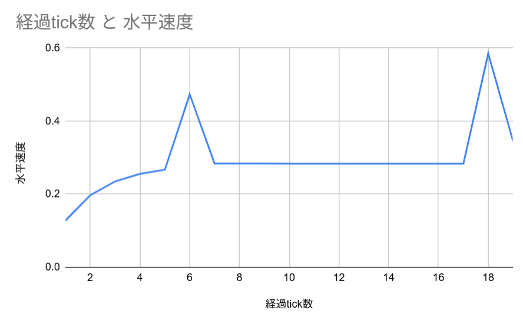
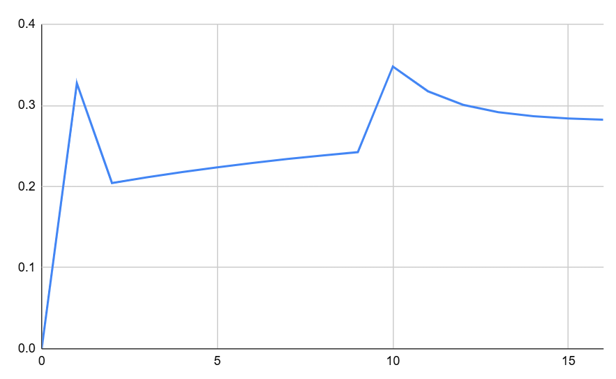

# 第3部 ダッシュジャンプの分析

# 1. 状態の分類

## 1.1 状態の見通し

この章では通常の地面でダッシュジャンプをした時の水平方向の速度について扱う。

この章で扱う状態は「(前tickの床) × (今tickの床) × (ジャンプしたか)」の組み合わせから得られる6個である。

これらを順に説明してく。

はじめに、ダッシュジャンプの状態をしている際に起こり得る状況の種類を整理する。

このときに重要なのは、速度の式が $S_{t}$ だけでなく $S_{t-1}$ を含んでいる点である。

そのため、現在の状態と過去の状態のどちらかが違えば、それは別の状態となる。

時刻 $t-1$ と $t$ における、地面の状態は以下の4つに分類される。命名については後で説明する。

| 状態 | t-1 | t |
| --- | --- | --- |
| Ground | 地面 | 地面 |
| Flight | 地面 | 空中 |
| Air | 空中 | 空中 |
| Landing | 空中 | 地面 |

さらに、ジャンプを入力した瞬間、つまりY座標が上昇する瞬間については、特殊な処理がなされる。

そして、ジャンプ時の式にも $S_{t-1} ,\,S_t$ が含まれているため、一見するとジャンプもさらに4つの状態に分かれると思える。

しかし、あとで紹介するが、 $t-1,\,t$ の地面の状態のうち、あり得るのは、
(地面, 地面)と、(空中,地面)の2パターンだけである。なぜこの2パターンだけなのかは次の章で説明する。

ともかく、Jump の中には Ground と、Landing が含まれているので、それぞれの頭文字をとって、 Jump-G と、Jump-L と呼ぶことにする。

次の節から、これらの状態の式を見ていく。

## 1.2 Ground

この状態は、時刻 $t-1$ と $t$ でともに地面にいる状態である。

そのため、第2部で扱った式をそのまま使えるので、

$$
V_t = 0.546V_{t-1} +0.1274
$$

このような式になる。

## 1.3 Flight

この状態は、時刻 $t-1$ で地面、 $t$ で空中にいる状態である。

今は空中にいるので、式は空中の式を使う。

さらに、時刻 $t-1$ では地面にいるので、 $S_{t-1}=0.6$ を空中の式に代入することで式が求まる。

計算すると

$$
V_t=0.546V_{t-1}+0.02548
$$

と求まる。

## 1.4 Air

この状態は、時刻 $t-1$ と $t$ でともに空中にいる状態である。

そのため、第2部で扱った式をそのまま使えるので、

$$
V_t=0.91V_{H,t-1}+0.02548
$$

である。

## 1.5 Landing

この状態は、時刻 $t-1$ で空中、 $t$ で地面にいる状態である。

今は地面にいるので、式は地面の式を使う。

さらに、時刻 $t-1$ では空中にいるので、 $S_{t-1}=1.0$ を地面の式に代入することで式が求まる。

計算すると

$$
V_t=0.91V_{t-1}+0.1274
$$

と求まる。

## 1.6 Jump-G

この状態では、特殊な式を用いる。

MCPK wikiではジャンプの速度として、以下の式が掲載されている。

$$
V_{H,t}=V_{H,t-1}\times S_{t-1}\times 0.91 + 0.1\times M_t \times E_t \times \left(\dfrac{0.6}
{S_t}\right)^3+

\begin{cases}
0.2 & \text{ダッシュ}\\
0.0 & \text{それ以外}
\end{cases}

$$

これに各数値を代入すれば、

$$
V_t=0.546V_{t-1}+0.3274
$$

と求まる。この式は Ground の式に MCPK wikiのジャンプの速度の末項である、0.2を足した形になっている。

## 1.7 Jump-L

これも同様に先ほどの式に各数値を代入すると、

$$
=0.91V_{t-1}+0.3274
$$

と求まる。この式も Landing の式に0.2を足した形になっている。

## 1.8 ここまでのまとめ

ここまでをまとめると、次のような表に整理できる

| 状態名 | t-1の地面 | tの地面 | 適用される式 | 持ち越し係数 | 踏み切り係数 |
| --- | --- | --- | --- | --- | --- |
| Ground | 地面 | 地面 | 地面の式 | 0.546 | 0.1274 |
| Flight | 地面 | 空中 | 空中の式 | 0.546 | 0.02548 |
| Air | 空中 | 空中 | 空中の式 | 0.91 | 0.02548 |
| Landing | 空中 | 地面 | 地面の式 | 0.91 | 0.1274 |
| Jump-G | 地面 | 地面 | ジャンプの式 | 0.546 | 0.3274 |
| Jump-L | 空中 | 地面 | ジャンプの式 | 0.91 | 0.3274 |

# 2. 状態の遷移

## 2.1 シチュエーションの設定

地面を何tickかダッシュしたのち、ジャンプをすることを考える。

どのように状態が遷移していくか観察する。

しばらくの間、「5tickの助走をとってからジャンプし、その後着地した瞬間にジャンプする」というシチュエーションを考える。

実際に私がMinecraft内で実験し、観測した水平方向の速度変化は以下の表のようになった。

| 経過tick数 | Y座標 | 水平速度 |
| --- | --- | --- |
| 0 | 0 | 0 |
| 1 | 0 | 0.1274 |
| 2 | 0 | 0.19696 |
| 3 | 0 | 0.23494 |
| 4 | 0 | 0.25568 |
| 5 | 0 | 0.267 |
| 6 | 0.42 | 0.47318 |
| 7 | 0.7532 | 0.28384 |
| 8 | 1.0013 | 0.28377 |
| 9 | 1.1661 | 0.28371 |
| 10 | 1.2492 | 0.28366 |
| 11 | 1.2522 | 0.28361 |
| 12 | 1.1768 | 0.28356 |
| 13 | 1.0244 | 0.28352 |
| 14 | 0.7967 | 0.28349 |
| 15 | 0.4952 | 0.28345 |
| 16 | 0.1213 | 0.28342 |
| 17 | 0 | 0.28339 |
| 18 | 0.42 | 0.58529 |
| 19 | 0.7532 | 0.34505 |

この章の目標が、それぞれのtickの水平速度の更新に前節で求めた6つの式のどれを使えばよいのかを、Y座標の変化だけを見て分かるようになることである。

一見すると、毎tickごとに状態を整理し、式を当てはめていけば、いいだけに思うかもしれない。

しかし、重要な2つのルールを知らなければ、正しい式を使えないであろう。

そのため、次節からルールの紹介をしていく。

## 3.2 ルール1: 状態の遅延

助走の後の、ジャンプ前後の速度変化についてみていく。

ジャンプは6tick目に行われているので、その前後を抜き出すとこのようになっている。

| 経過tick数 | Y座標 | 水平速度 |
| --- | --- | --- |
| 5 | 0 | 0.267 |
| 6 | 0.42 | 0.47318 |
| 7 | 0.7532 | 0.28384 |

6→7tick目に注目したい。ここで急激な速度の減少が起きている。

ある人はこう考えるかもしれない。7tick目は空中で、6tick目も空中だから、使うべき式は Air の式であると。

確かにこう考えたく気持ちはわかるが、実際に使うのは別の式だ。

そもそも、速度の計算はいつ行われるのだろうか。

Minecraftでは速度を計算し、そこに位置を足すことで位置を更新している。

つまり、6tick目に位置があって、速度を計算し、7tick目の位置が決まる。

このとき、大きなすれ違いが起きている。

計算は、6tick目の位置更新がなされたあと、次なる速度を計算する。この時に参照するのは今の状態である。

そして、7tick目に位置更新が行われる。このときに、プレイヤーは座標変化から速度を読み取る。

つまり、Minecraft側が6tick目に参照した状態は今、すなわち6tick目の状態だが、プレイヤーがそれを観測するのは位置が更新されたあとの7tick目である。

ここに、1tickのずれが生じている。

プレイヤーが7tick目に観測した速度は、Minecraftが6tick目に計算した速度である。

そのため、7tick目での速度更新に使われた式は、1tick前の6tick目の条件である。

このように、計算と観測のずれによって、計算に使われる状態は1tick前の状態である。

tick t でMinecraftは速度を計算する。

その速度で tick t+1 の位置が決まる。

プレイヤーが読む「t+1の速度」は、実は t の計算結果である。

つまり、逆に見れば、状態が1tick遅れて作用するように見える。これを**状態の遅延**と呼ぶ。

具体例に話を戻すと、7tick目の速度 (正確には観測された速度) は、実際には6tick目に計算されたものである。計算に使うときに参照される状態は6tick目の状態なので、 Flightである。

よって、使うべき式は Flight となる。

## 3.3 ルール2: ジャンプはbを上書きする

5→6tick目の速度変化を考えよう。

ルール1通りに、状態が遅延するなら、ジャンプをした瞬間である6tick目ではなく5tick目の状態を見ることになる。

そして、それは Ground である。

となれば、普通に考えればGroundの式を使うのが妥当である。

しかし、その次のtickでは Flight の式を使っているので、じゃあ結局どこでジャンプしたの？という話になってしまう。

そこで、2つ目の重要なルールを紹介する。それは、ジャンプは状態を上書きするということだ。

先に正解を言うと、6tick目で使われた式は Jump-G の式である。

イメージとしては、5tick目時点で速度を計算しておいてGroundの用意をしていたが、6tick目でジャンプを入力したため、急いで0.2だけ足して Jump-G の式にした。

といった感じである。　

このように、ジャンプはその瞬間にGround→Jump-Gのように上書きをする。

コード風に表現するとこのようになる。

```jsx
b = ground_b
if jump: b = jump_b
```

## 3.4 シチュエーションの答え合わせ

「5tickの助走をとってからジャンプし、その後着地した瞬間にジャンプする」について考え、6つの式のうちどれを使えばいいか判断するための2つのルールを身に着けた。

- ルール1：状態は1tick遅れて効く
- ルール2：ジャンプは b を上書きする

あと悩むとすれば17→18tick目である。

ぜひ、ここはどの式を使えばいいか考えてもらいたい。

- 以下に状態と使うべき式をまとめた表 (答え)
    
    
    | 経過tick数 | Y座標 | 速度 | Y座標から推測できる見かけの状況 | 計算で使われた式 |
    | --- | --- | --- | --- | --- |
    | 0 | 0 | 0 | 接地 | Ground |
    | 1 | 0 | 0.1274 | 接地 | Ground |
    | 2 | 0 | 0.19696 | 接地 | Ground |
    | 3 | 0 | 0.23494 | 接地 | Ground |
    | 4 | 0 | 0.25568 | 接地 | Ground |
    | 5 | 0 | 0.267 | 接地 | Ground |
    | 6 | 0.42 | 0.47318 | 離陸 | Jump-G |
    | 7 | 0.7532 | 0.28384 | 空中 | Flight |
    | 8 | 1.0013 | 0.28377 | 空中 | Air |
    | 9 | 1.1661 | 0.28371 | 空中 | Air |
    | 10 | 1.2492 | 0.28366 | 空中 | Air |
    | 11 | 1.2522 | 0.28361 | 空中 | Air |
    | 12 | 1.1768 | 0.28356 | 空中 | Air |
    | 13 | 1.0244 | 0.28352 | 空中 | Air |
    | 14 | 0.7967 | 0.28349 | 空中 | Air |
    | 15 | 0.4952 | 0.28345 | 空中 | Air |
    | 16 | 0.1213 | 0.28342 | 空中 | Air |
    | 17 | 0 | 0.28339 | 着地 | Air |
    | 18 | 0.42 | 0.58529 | 離陸 | Jump-L |
    | 19 | 0.4297 | 0.34505 | 空中 | Flight |

- 解説
    
    まず、17tick目はルール1から、16tick目での状態を見ればよいので、見た目は着地しているが、使うべき式はAir だとわかる。
    
    次に、18tick目は17tick目の状態を見ると着地であり、さらに18tick目にジャンプ入力がされているので、使うべき式は Jump-L だとわかる。
    

## 3.5 発展問題

1. 空中 → 着地 → 2tickだけ助走 → ジャンプ → 空中
2. 空中 → 着地 → 1tickだけ助走 → ジャンプ → 空中

といった動きをしたときの、状態の Air から Air までの遷移をそれぞれ書け。

- 解答
    1. Air → Landing → G → Jump-G → Flight → Air
    2. Air → Landing → Jump-G → Flight → Air
    

# 4. 6つの式の理解

第8章では、ジャンプが「状態の遅延」と「b の上書き」によって横方向の速度を作ることを見た。

この章では一歩進めて、

> そのエンジンが、どれくらい強いのか？
> 
> 
> **どの状態が本当に速くなるのか？**
> 

を、数式と数値で測っていく。

## 4.1 6式の特徴

第2部で使った線形更新式は $V_t=aV_{t-1}+b$ という形であり、今部第2章で示した6つの式は、いずれも線形更新式である。

そして、式の意味を改めて確認しておく。

- $a$ : 過去の速度をどれだけ持ち越すか
- $b$ : 今どれだけ踏み切ることで速度を与えるか

これまで扱ってきた6つの状態は $a,b$ が異なるだけの式である。

ここで、各状態の持ち越し係数と踏切係数を再掲する。

| 状態名 | 持ち越し係数 a | 踏み切り係数 b |
| --- | --- | --- |
| Ground | 0.546 | 0.1274 |
| Flight | 0.546 | 0.02548 |
| Air | 0.91 | 0.02548 |
| Landing | 0.91 | 0.1274 |
| Jump-G | 0.546 | 0.3274 |
| Jump-L | 0.91 | 0.3274 |

この表を見るだけで、すでに重要なことが分かる。

- 持ち越し係数は Air , Landing , Jump-L が最大
- 踏み切り係数は Jump-G, Jump-Lが最大で、Ground と Landingも十分大きい。

このことから、

**空中の $a=0.91$ を保ったまま、地面やジャンプの $b$ を使っている**。

つまり

> Landing と Jump-L は
「滑りながら蹴っている」状態
> 

である。

次の節で、各式の終端速度を求めるとで、各式の最大速度を計算する。

## 4.2 終端速度

6個の状態の終端速度をもとめ、小さい順に並べたのがこれである。

| 状態名 | 終端速度 | 持ち越し係数 | 踏み切り係数 |
| --- | --- | --- | --- |
| Flight | 0.0561 | 0.546 | 0.02548 |
| Ground | 0.2806 | 0.546 | 0.1274 |
| Air | 0.2831 | 0.91 | 0.02548 |
| Jump-G | 0.7211 | 0.546 | 0.3274 |
| Landing | 1.4156 | 0.91 | 0.1274 |
| Jump-L | 3.6378 | 0.91 | 0.3274 |

終端速度はこれらの式で到達できる最大の速度を表している。

いわば、どの状態がもっとも速度に寄与するかを示してくれるものである。

いかに Jump-L の性能が異常か、そして、意外と Landing の性能がいいことが分かるだろう。

それぞれの強みが分かるグラフを用意した。

以下は、このシチュエーションでの水平速度の変化を示したものである。

これは前章で試したシチュエーションで、6tick目の Jump-G で大きく上昇しているが、18tick目の Jump-Lは異常なまでに速度が増加していることが分かる。



次のシチュエーションは、「同時押しでスタートし、1ブロック乗り上げた後地面に居続ける」という動きである。

以下は、このシチュエーションでの水平速度の変化を示したものである。

1tick目の Jump-G である程度の速度を得たのち、 Flight により大きく減速、その後は Air の終端速度より小さく、持ち越し係数が大きいのでなだらかに上昇し、 Landing によって中程度の加速をする。その後は Flight のような急ブレーキはないので、ある程度の速度で Ground により速度が終端速度に向かっていくことが読み取れる。



## 4.3 ダッシュジャンプという操作の正体

ここまでの話をまとめると、

着地した瞬間にジャンプするダッシュジャンプとはこう定義できる。

> ダッシュジャンプとは、
持ち越し係数の高い空中に、
Jump-L による最大の速度を送り続ける操作
> 

# 5. まとめ

この部では、Minecraftのジャンプが単に「上に跳ぶ操作」ではなく、横方向の速度に割り込むエンジンであることを示した。
速度は線形更新式で更新されることと、その際の重要な2つのルールを紹介した。

- 使われる式は1tick遅れて決まり
- ジャンプはその $b$ を上書きできる

これにより6つの状態が生まれ、特にLandingとJump-Lは空中の慣性を保ったまま大きな踏み切りを使えるため非常に強い。

ダッシュジャンプとは、この最強のエンジンを空中に送り続ける操作である。

---

[← 前に戻る](02.md) ｜ [1](01.md) ｜ [2](02.md) ｜ [3](03.md)
